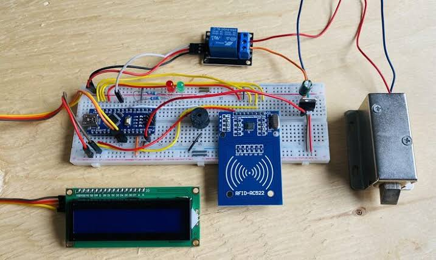

# 🔐 Password Based Lock System with RFID

A door lock system built on an Arduino Nano. Access is granted either by entering the correct password on a 4x4 keypad or by scanning an authorized RFID card. A relay controls a 12V solenoid door lock, and an LCD shows the result.

## 📌 Problem
Traditional keys can be lost, copied or shared. I wanted a simple lock that opens only for someone who knows the password or holds an authorized RFID card.

## 💡 Solution
The Arduino Nano reads the keypad and the RC522 RFID reader. If the password or card is valid, it switches a relay that powers a solenoid lock for a few seconds so the door can open, then locks again. The LCD shows "Access Granted / Door Unlocked" or "Access Denied / Incorrect".

## 🔧 Components Used

| Qty | Component | Purpose |
|-----|-----------|---------|
| 1 | Arduino Nano | Main controller |
| 1 | RC522 RFID reader + authorized cards/tags | Card authentication |
| 1 | 4x4 matrix keypad | Password entry |
| 1 | 16x2 I2C LCD | Status messages |
| 1 | Relay module (1-channel) | Switches the lock's power |
| 1 | Solenoid door lock (12V) | Locks the door |
| 1 | 12V power supply for the lock | Powers the solenoid lock |
| 1 | [Power source for the Nano, e.g. USB / 5V adapter] | Powers the controller |
| - | Jumper wires, [optional: 1N4007 diode] | Connections |

## ⚙️ How It Works
1. The LCD shows "Enter Password / or Scan Card".
2. **Password:** type the digits on the keypad (shown as `*`), press `#` to submit, or `*` to clear.
3. **RFID card:** hold a card near the RC522. Its UID is compared with the list of authorized UIDs stored in the code.
4. **Valid password or card:** LCD shows "Access Granted / Door Unlocked", the relay powers the solenoid lock for 5 seconds so the door can be opened, then the lock engages again.
5. **Invalid password or card:** LCD shows "Access Denied / Incorrect" and the door stays locked.

## 🔌 Circuit Connections

> ⚠️ Power everything OFF while wiring. Double-check before switching on.
> **All grounds (GND) of the Arduino, relay module, LCD and RC522 must be connected together.**

### Block diagram

```
                       ┌────────────────┐
  4x4 Keypad ─────────►│                │────► 16x2 I2C LCD
  (D2-D8, A0)          │  Arduino Nano  │      (A4, A5)
  RC522 RFID ─────────►│                │
  (SPI: D9-D13)        └───────┬────────┘
                               │ A1
                          ┌────▼─────┐   COM / NC   ┌────────────────┐
                          │  RELAY   │─────────────►│ Solenoid lock  │◄── 12V supply
                          └──────────┘              └────────────────┘
```

### 1. RC522 RFID reader → Arduino Nano

| RC522 pin | Nano pin |
|-----------|----------|
| SDA (SS) | D10 |
| SCK | D13 |
| MOSI | D11 |
| MISO | D12 |
| RST | D9 |
| 3.3V | 3V3 |
| GND | GND |
| IRQ | not connected |

**Important:** power the RC522 from **3.3V**, not 5V.

### 2. 4x4 keypad → Arduino Nano

The keypad has 8 pins. From left to right (front view): R1, R2, R3, R4, C1, C2, C3, C4.

| Keypad pin | Nano pin |
|------------|----------|
| R1 | D2 |
| R2 | D3 |
| R3 | D4 |
| R4 | D5 |
| C1 | D6 |
| C2 | D7 |
| C3 | D8 |
| C4 | A0 |

### 3. 16x2 I2C LCD → Arduino Nano

| LCD pin | Nano pin |
|---------|----------|
| SDA | A4 |
| SCL | A5 |
| VCC | 5V |
| GND | GND |

If the LCD stays blank, change the I2C address in the code from `0x27` to `0x3F`, and adjust the contrast screw on the back.

### 4. Relay module → Arduino Nano

| Relay pin | Nano pin |
|-----------|----------|
| IN | A1 |
| VCC | 5V |
| GND | GND |

Most relay modules are **active-LOW**. If yours works the other way round, set `RELAY_ACTIVE_LOW` to `false` in the code.

### 5. Solenoid lock circuit (12V, separate supply)

A solenoid lock keeps its bolt extended (**locked**) when it has no power, and pulls the bolt back (**unlocked**) while it is powered. So the relay is wired to the **NO** (normally open) contact:

```
 12V supply (+) ──► Relay COM
                    Relay NO ──► Solenoid lock (+)
 12V supply (−) ──► Solenoid lock (−)
```

- Relay **OFF** → no power to the lock → door **locked**.
- Relay **ON** → lock powered → bolt retracts → door **unlocked**.
- Strongly recommended: put a 1N4007 diode across the lock terminals (stripe/cathode towards the **+** side) to absorb voltage spikes from the coil.

## ▶️ How to Run
1. Install the Arduino IDE.
2. Install these libraries from the Library Manager: **MFRC522**, **Keypad**, **LiquidCrystal I2C**.
3. Open `rfid_password_lock/rfid_password_lock.ino`, select board **Arduino Nano**, and upload.
4. Open the Serial Monitor (9600 baud) and scan a card. Its UID is printed. Copy it into `AUTHORIZED_UIDS` in the code, then upload again.
5. Change `PASSWORD` in the code to your own password.

## ⚠️ Limitations
- The password and authorized card UIDs are fixed in the code, so changing them needs re-uploading.
- This is a learning prototype. It is not a certified security product, so don't use it to protect anything valuable.
- A solenoid lock stays locked when it has no power, so during a power cut the door cannot be opened electronically.

## 🛠️ Tech Stack
C++ (Arduino framework), SPI and I2C communication, relay switching

## 📸 Demo
[Project ki photo / video yahan lagao]



## 🧠 Challenges & Learnings
- [Ek real challenge jo tumhe aaya aur kaise solve kiya]
- [Ek cheez jo is project se seekhi]

   ## 👤 Author
   Abhaypratap Sikarwar
   [LinkedIn](https://www.linkedin.com/in/abhaypratap-sikarwar-a5b9792b1/) | [Portfolio](https://abhaysikarwar.netlify.app) | [Portfolio 2](https://abhaysikarwar326.netlify.app)
